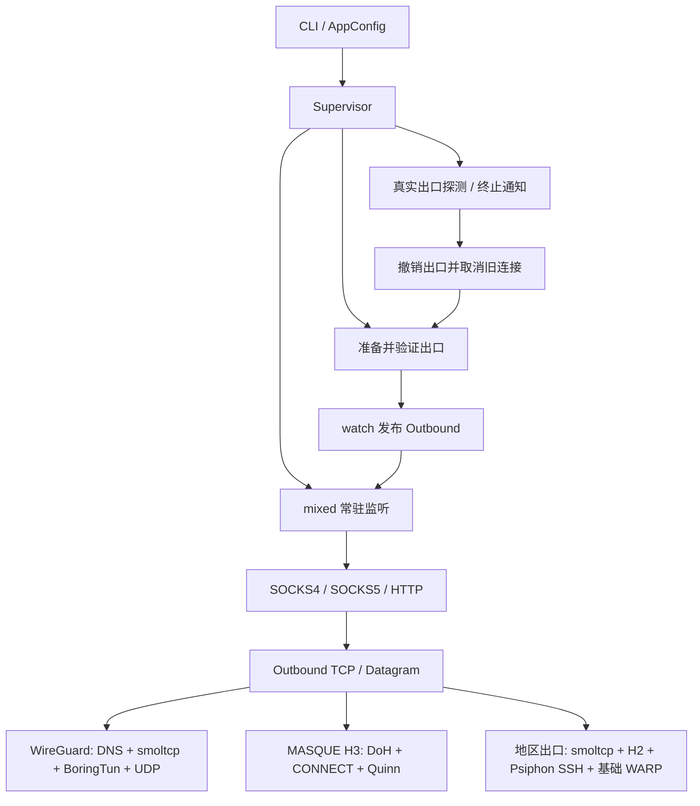

# 架构审查与局部重构（2026-10-31）

本轮依据工作区源码、锁定依赖和本地测试。覆盖启动编排、协议入口、出口组合、DNS、IP 栈、传输生命周期、状态持久化及构建配置；不等同于所有输入的协议合规审计或线上性能验收。已有驱动背压修改继续保留。

## 架构与数据流

- 监听属于进程，出口属于一轮恢复周期；`watch` 切换使旧连接退出，避免原地替换正在使用的协议状态。
- 协议模块负责握手、回复和 HTTP 消息边界；`relay` 负责 CONNECT 字节转发和半关闭排空。
- `Outbound` 隔离业务协议与出口。WireGuard/H2 共用 `outbound/ip.rs`，H3 有独立 DNS/开流/重连预算。
- `Net` 持有 reactor，socket 持有共享 reactor 引用；socket handle 析构释放表项。设备由单 reactor 驱动，避免拆分 BoringTun 状态所有权。
- H2 用有界 packet channel 连接网络栈与收发任务；H3/Psiphon 用 duplex 桥接字节流，返回流负责取消后台任务。两种流的 EOF 契约不同，不能仅为消除表面重复合并。
- 注册和 endpoint 历史持久化；健康心跳仅表示最近成功探测，Docker 不执行恢复决策。

## 按优先级列出的问题

| 优先级 | 位置 | 证据与影响 | 本轮处理 |
| --- | --- | --- | --- |
| 高 | `outbound/masque/doh.rs::read_http_response` | 接受任意 Content-Length，持续增长 body；外层超时限制时长，不限制期间内存增长 | 报告待修；大小限制会改变异常响应行为，单独设计与验证 |
| 中 | `outbound/ip.rs::connect_first` 与 `compose.yaml` | 每业务域名连接可有 4 个在途 TCP socket，每个 RX+TX 为 512 KiB；64 业务连接对应约 128 MiB 的候选缓冲，尚不含协议、基础隧道、队列和运行时 | 容量推导，不是已测 OOM；先采集 RSS/候选并发峰值再调整预算 |
| 中 | `outbound/masque/qpack.rs` 原整数编码 | 大整数分支逐 bit shift 却每次输出一个 byte；2^30 临时复现得到 57 字节而非 8。H2 另有只覆盖小范围的编码器 | 统一使用已锁定 `quinn-proto::coding::Codec`；当前实际帧长度域字节保持一致，潜在大值错误得到修正 |
| 中 | `dns.rs` / `outbound/masque/doh.rs` | 缓存命中/淘汰、大小写和地址族策略不一致；没有同名查询合并。冷缓存并发可能重复解析 | 不直接合并两个缓存：返回值与否定结果契约不同；先验证重复查询规模 |
| 中 | `tunnel.rs::handshake/pump_once/tick/try_tick` | 启动与运行期各自解释 BoringTun 输出；握手 timeout 从 decoy 和首次发送之后计时，只有上层 120 秒预算覆盖完整准备过程 | 保留行为；后续先定义“握手超时”是否包含 decoy，再考虑共用驱动 |
| 低 | `registration/masque.rs` | 手工复制全部字段，新增字段容易遗漏；“浅克隆”注释不准确 | 使用 derive(Clone)，保留字段值和序列化格式 |
| 低 | `masque::drain_upload` | 每次读取都构造新 DATA frame Vec；每帧重新分配并复制负载 | 复用每流帧缓冲；保留一次负载复制和一次 write_all，避免未经测量地改写为两次发送 |
| 低 | `appconfig.rs` / `health/probe.rs` / `socks5.rs` / `outbound/ip.rs` | 注释仍描述旧 40 秒恢复估计、经 SOCKS 健康探测、边缘直接解析、TCP 使用 UDP 解析 helper | 修正文案，运行逻辑不变 |

## 从零设计时保留与调整的边界

保留“Supervisor 管生命周期、协议入口管消息、Outbound 管拨号、Net 管 IP 驱动”的四层结构。它与实际资源寿命一致，没有必要引入通用插件框架、统一重试器或新的任务管理器。

本轮局部重构：

1. 将真正相同的 QUIC 整数编码归属于 `masque/varint.rs`，只包装现有 Quinn API；QPACK 前缀整数仍归 QPACK，不能混用。
2. 每流按需增长并复用 DATA frame 缓冲，不引入全局池或共享锁；代价是活跃流保留峰值容量直到释放，最大业务负载为 64 KiB。
3. 用语言派生机制维护克隆，避免镜像字段清单。
4. 保留上一轮 reactor 的单设备、有界队列和独立收发轮询契约；不为减少代码删除流控或退出逻辑。

后续独立工作项：

1. 给 DoH HTTP 响应定义明确大小和分帧契约，临时验证超长 Content-Length、截断、分块响应。
2. 在目标 ARM/cgroup 环境测量并发拨号、TLS/QUIC、诊断计数的 CPU/RSS；依据数据决定容量预算，不能凭文件大小宣称瓶颈。
3. 整理握手总预算及启动/运行计时语义，再统一 BoringTun 输出处理；这会涉及行为契约，不能夹带进等价重构。
4. 若同名冷查询确有放大，再添加每出口的查询合并；取消、缓存失效、错误共享需要单独设计。

## 验证与边界

- 本地现有 73 项测试覆盖格式编码、DNS、地址族选择、socket 回收、UDP worker 生命周期等；不等于完整代理入口与远端协议验收。
- 临时副本 `/private/tmp/warp-driver-20261031` 保留驱动故障复现及协议边界验证，不向仓库添加维护测试。
- 整数验证覆盖 1/2/4/8 字节边界、截断和尾随数据；0..65536 编码逐值对照旧有效域规则。
- DATA frame 验证覆盖长度边界、连续复用及缓冲指针稳定；证明无逐帧重新分配，不证明实际吞吐提升。
- 未升级依赖、未改部署配置、未连接生产设备；WARP/H2 端到端和现场故障根因仍待线上证据。
